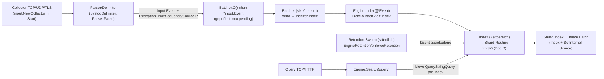

# Ekanite — Architektur (normativ)

> **Status:** Normatives Referenzdokument für Maintainer (Issue #79, MS6/C1).  
> **Geltungsbereich:** Ableitungen aus dem aktuellen Code auf Branch `task/79`. Wo der Code uneindeutig oder widersprüchlich ist, ist dies explizit markiert (`[INFERENCE]`, `[RISIKO]`). Dieses Dokument erhebt keinen Absolutheitsanspruch; bei Konflikt gilt der Code, Abweichungen sind als Issue zu erfassen.  
> **Ausnahme — §5:** Der Such-Stack wird auf **SQLite + FTS5** umgestellt (Epic #157, entschieden; Vertrag mit #158 festgeschrieben). §5 beschreibt den **Zielzustand**; in diesem Abschnitt gilt der Vertrag, **nicht** der Code. §1–§4 und §7 beschreiben weiterhin den Ist-Zustand (bleve) und werden mit #167 nach dem Cutover (#164) nachgezogen.

## 1. Überblick

Ekanite ist ein Syslog-Index-/Suchdienst in Go ohne externe Laufzeitabhängigkeiten (eingebetteter Index; **Ist:** [bleve](https://github.com/blevesearch/bleve), **Ziel:** SQLite + FTS5 nach §5). Er nimmt Logzeilen entgegen, indexiert sie zeitlich partitioniert und stellt sie über eine Suchschnittstelle bereit.

| Komponente | Rolle |
|---|---|
| **Eingang (Collector)** | Nimmt Zeilen über TCP/UDP (optional TLS für TCP) entgegen (`input.Collector`, `input.NewCollector`). |
| **Parser/Delimiter** | Trennt Nachrichten (Syslog-Delimiter) und parst Formate `syslog`/RFC5424 oder `fortios` (`input.Parser`/`NewParser`, `parser.RFC5424`, `parser.FortiOS`). |
| **Ingest/Batching** | Puffert Eingangsereignisse und bündelt sie zu Index-Batches (`ekanite.Batcher`, `NewBatcher`, `Start`, `C`). |
| **Index (Engine/Index/Shard)** | Schreibt Batches zeitbereichsbezogen in Shards (`Engine`, `Index`, `Shard`, `Event`). **Ist:** bleve-Shards; **Ziel:** SQLite-Store + FTS5 (§5). |
| **Retention** | Entfernt abgelaufene Zeit-Indizes periodisch (`Engine.runRetentionEnforcement`/`enforceRetention`, `Index.Expired`, `DeleteIndex`). |
| **Query** | Führt Suchen über die Zeit-Indizes aus und streamt Treffer (`Engine.Search`, TCP-`Server`, HTTP-`HTTPServer`). |

## 2. Datenfluss (Pipeline)

**Startup-Reihenfolge** (`cmd/ekanited/main.go`, `main`): Datenverzeichnis/Retention parsen → `GOMAXPROCS` → Diag-Server (`startDiagServer`, expvar/pprof) falls `-diag` → `NewEngine` + `Open()` (lädt bestehende Indizes, startet Retention-Goroutine) → Query-Server TCP/HTTP falls konfiguriert → `NewBatcher` + `Start` + Fehler-Drain → TCP-Collector → UDP-Collector → Profiling → auf Signal warten → `engine.Close()` → Profiling stoppen. Collector-Start erfolgt **nach** dem Batcher; Query-Server starten nach `engine.Open()`.

## 3. Komponenten & Verantwortlichkeiten

- **`Engine`** (`engine.go`): Hält `indexes` (zeitliche `*Index`-Liste, sortiert), Konfiguration (`NumShards`, `IndexDuration` 24h, `RetentionPeriod`, `RetentionCheckInterval` 1h), Lifecycle (`Open`/`Close`). `Index()` demultiplext Batches auf passende Zeit-Indizes, erzeugt fehlende Indizes lazy, indexiert Sub-Batches parallel. `Search()` iteriert Indizes und streamt Dokumentquellen. `Total()` aggregiert Shard-DocCounts.
- **`Index`** (`index.go`): Repräsentiert einen Zeitbereich `[startTime, endTime)` (Verzeichnisname `20060102_1504`, Endzeit in Datei `endtime`). Enthält `Shards []*Shard` und ein `bleve.IndexAlias` über alle Shards für Suche. Routet Dokumente per Hash auf Shards (`Shard(docId)`) und führt Suche/Fetch aus. `[IST]` **Ziel:** dieselbe Zeitfenster-/Shard-Struktur, Suche über SQL/FTS5 statt `bleve.IndexAlias` (§5).
- **`Shard`** (`index.go`): Dünne Hülle um einen `bleve.Index` (Pfad pro Shard, z. B. `0000`). `Open()` erzeugt/öffnet Mapping (`buildIndexMapping`, Analyzer `ekanite`). `Index()` schreibt per `bleve.Batch` (`Index` + `SetInternal` für Source). Kein eigener Mutex im Code. `[IST]` **Ziel:** eine SQLite-Datei je Shard, Rohzeile genau einmal (`docs/sql/search-schema.sql`), Lifecycle/Retention/Wipe siehe §5 und #161.
- **`Batcher`** (`engine.go`): Nimmt `*input.Event` auf Kanal `C()` (Kapazität `max`) entgegen. Flush bei `size` Elementen oder nach `duration` (Timer, Reset bei erstem Element des Batches). Ruft `EventIndexer.Index` (implementiert von `Engine`).
- **`Collector`** (`input/collector.go`): `TCPCollector`/`UDPCollector` erzeugen Parser (`NewParser(format)`, Formate `syslog`/`fortios`), setzen `ReceptionTime = time.Now().UTC()`, `Sequence = atomic.AddInt64(&sequenceNumber,1)` (global, initial `time.Now().UnixNano()`), `SourceIP`, und senden akzeptierte Events in den Batcher-Kanal. TCP nutzt `SyslogDelimiter` und Read-Deadline (`newlineTimeout` 1000ms).
- **Query-Server** (`server.go`, `server_http.go`): TCP liest zeilenweise Queries, schreibt Trefferzeilen und beendet mit `\n\n`. HTTP (`POST` Feld `query`) sammelt alle Treffer und rendert HTML; `GET`/`HEAD` liefert Index. Beide nutzen das `Searcher`-Interface (`Engine`).

## 4. Invarianten

### 4.1 Zeitnormalisierung
- **Referenzzeit:** `input.Event.ReferenceTime()` (`input/event.go`): memoisiert in `referenceTime`. Ist `Parsed == nil`, gilt `ReceptionTime`. Ist `Parsed != nil`, wird `time.Parse(time.RFC3339, e.Parsed["timestamp"].(string))` versucht; bei Parse-Fehler Fallback auf `ReceptionTime`, sonst der geparste Zeitstempel.
- **Ohne/fehlerhafter Zeitstempel:** `Parsed == nil` → `ReceptionTime`. `[RISIKO, Codepfad]` Der Zugriff `e.Parsed["timestamp"].(string)` erfolgt ohne Guard: fehlt der Schlüssel oder ist der Wert kein `string`, löst die Go-Typzusicherung eine Panic aus (kein Fallback). RFC5424 legt `timestamp` als Rohwert `m[3]` ab (`parser/rfc5424.go`); ist dieser nicht RFC3339, scheitert das RFC3339-Parsing und es greift der Fallback auf `ReceptionTime`. FortiOS normalisiert `date`/`time` zu RFC3339 (`parser/fortios.go`, `fortiOSTimestamp`/`Parse`).
- **`ReceptionTime`:** Wird beim Empfang auf `time.Now().UTC()` gesetzt (Collector).

### 4.2 DocID- und Shard-Aufteilung
- **DocID:** `Event.ID()` (`event.go`) = `fmt.Sprintf("%016x%016x", uint64(e.ReferenceTime().UnixNano()), uint64(e.Sequence))` (`DocID`, 32 Hex-Zeichen). Most-significant 16 Zeichen = Referenzzeit in Nanosekunden, least-significant 16 = Sequenz. `DocIDs.Less` sortiert nach msw, dann lsw (zeit-/sequenzstabil).
- **Zeit-Index (grobe Partition):** `Engine` wählt/erzeugt pro `ev.ReferenceTime()` einen `Index` (`indexForReferenceTime`/`createIndexForReferenceTime`). Bereich: `start = rt.Truncate(IndexDuration).UTC()`, `end = start + IndexDuration` (`DefaultIndexDuration` 24h, `engine.go`). Enthält-Zeitraum: `[startTime, endTime)` (`Index.Contains`). Namenskollision gleicher Startzeit wird durch Verschieben von `startTime` auf `idx.endTime` behandelt (`createIndex`) — `[INFERENCE]` der Kommentar im Code weist auf einen möglichen Restfall bei weiterer Kollision hin (`XXX`); kein Schleifen-Ausgleich im Code.
- **Bleve-Subshards (Routing):** Innerhalb eines `Index` wird ein Dokument einem `Shard` zugeordnet: `fnv.New32a()` über `[]byte(docId)`, `Sum32() % uint32(len(i.Shards))` (`Index.Shard`). Anzahl Shards pro Zeit-Index = `Engine.NumShards` (Default in `engine.NewEngine`: 16; **effektiver CLI-Default über `cmd/ekanited/main.go`: `-numshards` = 4**, `DefaultNumShards=4`).
- **Suche über Partitionen:** `Engine.Search` iteriert `e.indexes` **rückwärts** (`len-1` → `0`). `Indexes` sind sortiert nach absteigendem `endTime` (bei Gleichstand absteigendem `startTime`, `Indexes.Less`), d. h. Index 0 ist der jüngste Bereich; die Rückwärtsiteration durchsucht damit vom **ältesten zum jüngsten** Zeitbereich (Kommentar: „starting with the earliest in time“). Pro Index liefert `Index.Search` per bleve Treffer-IDs, sortiert sie als `DocIDs` aufsteigend und streamt die Quellen.

### 4.3 Lock-Reihenfolge & -Stile
- **`Engine.mu sync.RWMutex`** schützt `e.indexes` und Open-Zustand-nahe Operationen: `Total`/`Search` halten `RLock`; `enforceRetention` hält `Lock`; `Open`/`Close` mutieren Indexliste (Lifecycle-Kontext).
- **`Engine.Index` (Lock-Upgrade-Muster, #13-relevant):** Hält eingangs `RLock` (defer `RUnlock`). Fehlt ein Ziel-Index, wird innerhalb einer anonymen Funktion `RUnlock()` → `Lock()` genommen, unter `Lock` re-geprüft und ggf. `createIndexForReferenceTime` ausgeführt, dann `Unlock()` → `RLock()` wiederhergestellt. `[RISIKO, #13]` Dieses manuelle Downgrade/Upgrade ist fehleranfällig (Fenster zwischen Unlock/Lock, Halten von RLock über I/O-nahe Arbeit) und ist als bekannte Race-Stelle zu behandeln; Reihenfolgeänderungen nur mit Bezug auf #13.
- **`Index`/`Shard`:** Kein eigener Mutex im Code. `Index.Index` parallelisiert pro Shard (`sync.WaitGroup`); `Shard.Index` nutzt `bleve.Batch` auf dem Shard-Index. `[INFERENCE]` Nebenläufigkeitssicherheit auf Shard-Ebene hängt von bleve bzw. der aufrufenden Serialisierung ab; der Code serialisiert Schreibzugriffe nicht explizit über einen Shard-Lock.

### 4.4 Batch-Semantik
- **Parameter (CLI-Defaults, `main.go`):** `-batchsize` 300, `-batchtime` 1000 ms, `-maxpending` 1000 (Kanalpuffer `NewBatcher`: `make(chan *input.Event, max)`).
- **Flush:** `Batcher.Start` flusht, wenn `len(batch) == size` (Timer gestoppt) oder bei Timer-Ablauf (`batchTimeout`). Erfolgreicher Flush: `EventIndexer.Index(batch)` liefert `nil` → Stats inkrementiert, **neues leeres Batch** angelegt. `errChan` erhält den `err`-Wert nur im Erfolgszweig des aktuellen Codes (`if errChan != nil { errChan <- err }` nach erfolgreichem Index); bei Indexfehler wird `batchIndexedError` gezählt und `send()` kehrt zurück **ohne** Batch-Reset.
- **Garantien/Durabilität:** Ein Event gilt erst als verarbeitet, wenn `Engine.Index` die Shard-Batches (`Shard.Index` → `s.b.Batch`) erfolgreich abschließt. `[RISIKO]` Bei Fehlern aus `Engine.Index`/`Shard.Index` bleibt das Batch im Fehlerpfad des aktuellen `send()`-Codes erhalten; je nach Triggerpfad kann dies zu Wiederholungsversuchen/Duplikaten oder (bei size-Trigger: Timer gestoppt, Batch nicht zurückgesetzt) zu ausbleibenden weiteren size-Flushes führen. Kein End-to-End-Ack an den Collector über den Kanal hinaus.

### 4.5 Retention
- **Parameter:** `-retention` Default `168h` (`main.go`); Hilfe/Flagtext nennt „Minimum is 24 hours“, **aber im Code wird kein Minimum erzwungen** (nur `time.ParseDuration` in `main`; `engine.DefaultRetentionPeriod` = 24h). `[INFERENCE]` Werte < 24h sind technisch parsebar, sofern gültige Duration — beabsichtigtes Minimum ist im Code nicht durchgesetzt.
- **Ablauf:** `Engine.runRetentionEnforcement` prüft alle `RetentionCheckInterval` (1h, `engine.go`). `enforceRetention` nimmt `Engine.mu.Lock`, prüft `i.Expired(time.Now().UTC(), e.RetentionPeriod)` (`endTime.Add(r).Before(t)`), ruft `DeleteIndex` (schließt, dann `os.RemoveAll(i.path)`) und entfernt den Index aus `e.indexes`.
- **Konsistenz:** Löschung erfolgt unter Engine-Lock; parallele Suche/Indexierung koordinieren über `Engine.mu`. `[INFERENCE]` Laufende Such-Goroutinen halten ggf. Index-Referenzen über den Snapshot hinaus; DeleteIndex schließt den Index — exakte Nebenläufigkeitswirkung beim gleichzeitigen Zugriff ist aus dem Code allein nicht vollständig spezifiziert.

### 4.6 Reihenfolge-Garantie (Suche)
- Ergebnisse werden nach **Event-Zeit (Referenzzeit)** geliefert, nicht nach Ingest-Reihenfolge: `Engine.Search` traversiert Zeit-Indizes vom ältesten zum jüngsten; `Index.Search` sortiert Treffer-`DocID`s aufsteigend (`DocIDs.Less`, msw = `ReferenceTime().UnixNano()`, lsw = `Sequence`) und streamt anschließend die Dokumentquellen. `[INFERENCE]` Globale Ordnung über Indexgrenzen folgt der Zeitbereichsaufteilung; innerhalb eines Bereichs der DocID-Ordnung.

## 5. Such-Stack-Vertrag (Zielzustand: SQLite + FTS5)

> **Dieser Abschnitt ist Zielzustand, keine Code-Ableitung.** Normativ sind dieses Kapitel und die
> Artefakte [`docs/SEARCH-STACK.md`](SEARCH-STACK.md) (Begründung, Semantik, Messwerte) sowie
> [`docs/sql/search-schema.sql`](sql/search-schema.sql) (ausführbares DDL). Bei Konflikt gilt in diesem
> Abschnitt der Vertrag. Umsetzung: #159–#167; #167 zieht danach die Ist-Abschnitte nach.

**Struktur (unverändert):** ein Store je (Zeitfenster, Shard). Zeitfenster-/Shard-Routing, Retention per
Datei-Drop und `WipeIndex` bleiben bestehen; Dateilayout, WAL und Checkpoint regelt #161.

### 5.1 Schema

`events` (genau eine Zeile je Ereignis): `id` (Rowedi), `ts`/`recv` (Unix-Nano, `int64`), `seq`
(Tie-Break), `host`, `app`, `pid`, `severity`, `facility`, `priority`, `version`, `msgid`, `srcip`,
`msg` (geparster Nachrichtentext), `raw` (vollständige Rohzeile; `NULL` bei `-rawmode drop`, #163),
`fields` (JSON: alle übrigen Parser-Felder, z. B. FortiOS-KV).

`events_fts` = `fts5(raw, content='events', content_rowid='id', tokenize='unicode61')` —
**external content**: die Rohzeile wird genau **einmal** gespeichert (in `events.raw`), FTS5 hält nur
den invertierten Index.

### 5.2 PRAGMAs

`journal_mode=WAL` (Leser parallel zum einen Schreiber), `synchronous=NORMAL`,
`busy_timeout=5000`, `cache_size=-65536`; `page_size` muss vor dem ersten `CREATE TABLE` gesetzt sein
(Referenz: Default 4096). Nach einem Bulk-Import einmal
`INSERT INTO events_fts(events_fts) VALUES ('optimize')`.

### 5.3 Indizes

Standardmäßig **nur** `events_ts(ts)` und `events_severity_ts(severity, ts)`. Jeder weitere Index
erhöht Disk/Event und ist nur mit Messung zulässig (#166).

### 5.4 Suchsemantik

- freie Terme → `events_fts MATCH ?`; FTS5-Ausdrücke (`AND`/`OR`/`NOT`, `"Phrase"`, `prefix*`, `NEAR()`)
  werden direkt durchgereicht;
- `field:value` (`app:apache`, `source_ip:10.0.0.3`, `severity:3`) → `WHERE spalte = ?` (typisiert,
  exakt; keine Tokenisierung von IPs/Zahlen);
- Zeitbereich → `WHERE ts BETWEEN ? AND ?` (Index `events_ts`);
- Kombination → `JOIN events e ON e.id = f.rowid ... WHERE f MATCH ? AND e.spalte = ? AND e.ts BETWEEN ? AND ?`;
- Ordnungsschlüssel `(ts, seq)` (total); Relevanz optional `ORDER BY bm25(events_fts)`;
- Trefferausgabe `SELECT raw` plus `snippet()`/`highlight()` (durch external content möglich).

### 5.5 Nicht-Ziele (bewusste Abweichung zu bleve)

Keine Fuzzy-/Edit-Distanz- und keine Regex-Suche (FTS5 kann beides nicht; Ersatz ist Prefix-Suche);
keine Term-Vektoren, keine DocValues, kein `_all`-Sammelfeld; keine Facetten (Aggregation über
`GROUP BY`).

### 5.6 Referenzmessung und offene Fragen

Messwerte dieser Konfiguration (363 B/Event, ~51.700 Events/s, Abfragezeiten) stehen in
`docs/SEARCH-STACK.md` §6. Offene Semantikfragen (externes Doc-ID-Format, Präsentationsreihenfolge,
Paging, Timeouts, `page_size`, `fields`-Kosten) sind dort in §7 gelistet und an #160/#163/#165/#166
delegiert.

## 6. Such-API

- **TCP** (`server.go`, `NewServer`/`Start`): Pro Verbindung werden Zeilen gelesen (CR/LF getrimmt), leere Zeilen ignoriert. Jede Query wird an `Searcher.Search` delegiert; Treffer (`string` pro Dokumentquelle) werden zeilenweise geschrieben, Fehler als Text in die Verbindung. Abschluss einer Query-Antwort: zwei Zeilenumbrüche (`\n\n`). Keine Authentifizierung im Code.
- **HTTP** (`server_http.go`, `NewHTTPServer`/`Start`): `GET`/`HEAD` liefert UI; `POST` mit Formularfeld `query` führt Suche aus, sammelt **alle** Treffer in einen Slice und rendert HTML (inkl. Trefferanzahl/Dauer). Leere Query fällt auf Index zurück. Fehler → HTTP 500/400. Keine Authentifizierung im Code.
- **Query-Sprache (effektiv):** `Index.Search` baut `bleve.NewQueryStringQuery(q)` und sucht über den Shard-Alias (`searchRequest.Size = maxSearchHitSize` 10000). Die UI verweist auf die bleve-Query-String-Syntax. Das frühere `query/`-Paket wurde entfernt (#32); die Abfragesprache ist ausschließlich bleve Query String.
- **Fehler-/Leerfälle:** Bleve-Suchfehler brechen den Engine-Scan ab (Log + `break`). Dokument-Fetch-Fehler pro ID werden geloggt und brechen den aktuellen Index-Lauf ab. `[INFERENCE]` Max. 10000 Treffer pro Index-Suchrequest (`maxSearchHitSize`); größere Treffermengen werden durch bleve/Request-Limit begrenzt.

## 7. Bekannte Grenzen & Risiken

- **#32 – Query-Logik:** erledigt — das tote `query/`-Paket wurde entfernt; die Suchsemantik folgt ausschließlich bleve Query String.
- **#13 – Lock-Muster:** behoben — `Engine.Search` hält den Read-Lock für die Suchdauer, `Close` wartet auf laufende Suchen (#49). Das manuelle `RUnlock`/`Lock`/`Unlock`/`RLock` bleibt nur im seltenen Nach-Anlegen von Zeit-Indizes in `Engine.Index`.
- **#52 / #78 – keine Authentifizierung:** TCP- und HTTP-Query-Endpunkte sowie (je nach Deployment) Diag-Bindung sind im Code nicht authentifiziert.
- **Exponiertes pprof/expvar:** Bei aktiviertem `-diag` bedient `status.Service` `/debug/vars` und `/debug/pprof/*` (`status/service.go`); `main` importiert zudem `_ "net/http/pprof"`.
- **Datenschutz:** Siehe `docs/PRIVACY.md` (Logdaten, Betriebs-/Zugriffsaspekte); Query/Diag-Exposition beachten.
- **Batch-Fehlerpfad:** behoben (#46/#7) — `Batcher.send` setzt das Batch auch im Fehlerfall zurück und meldet den Fehler auf `errChan` (kein unbegrenztes Wachstum, sichtbarer Fehler).
- **Index-Mapping vs. `Event.Data`:** behoben (#34) — `Event.Data()` liefert das Dokument mit allen geparsten Feldern (inkl. `source_ip` und Zeiten); ganze Werte (IPs/Hosts/app) nutzen den Keyword-Analyzer.
- **Index-Größe (bleve):** `[RISIKO]` gemessen **28,6 kB/Event** (100k RFC-5424, 4 Shards) — davon ~72 % aus dem **dynamischen Mapping** der geparsten Felder: jedes nicht explizit gemappte Feld (u. a. `timestamp`, alle FortiOS-Felder) wird zusätzlich gespeichert, invertiert, mit Term-Vektoren/DocValues und im `_all` abgelegt (~1,5–2 kB pro Feld und Event). Die Rohzeile macht nur ~1,4 % aus. Konsequenz: Migration auf SQLite + FTS5 (363 B/Event) — §5, Epic #157.
- **Retention-Minimum:** „Minimum 24h“ nicht erzwungen (siehe 4.5).

## 8. Review-Checkliste (C1, MS6-Änderungen)

Bei Änderungen an Ingest/Index/Query dieses Dokument und die folgenden Punkte gegen den Code prüfen:

1. **Lock-Reihenfolge/-Stil (`Engine.mu`, #13):** Halten `Index()`/`createIndex*`/`enforceRetention` konsistente Sperrkonventionen? Kein neues Upgrade/Downgrade ohne Begründung; RLock nicht über mutierende Pfade halten.
2. **Zeitbereichs-Index & Shard-Routing:** `IndexDuration`-Truncation, `[start,end)`-Semantik (`Contains`/`createIndexForReferenceTime`) und Shard-Hash (`fnv32a(DocID) % len(Shards)`, `Index.Shard`) unverändert oder Dokument + Migration bedacht.
3. **DocID/Zeitnormalisierung:** `Event.ID()` (msw = `ReferenceTime().UnixNano()`, lsw = `Sequence`), `ReferenceTime()`-Fallbacks und Parser-`timestamp`-Format (RFC3339-Erwartung) konsistent; kein ungeguardeter Panic-Pfad eingeführt/verschärft.
4. **Batch-Flush & Fehlerbehandlung:** `Batcher`-Trigger (`batchsize`/`batchtime`/`maxpending`), Reset/`errChan`-Verhalten bei Erfolg/Fehler, und Durabilitätsannahmen explizit.
5. **Retention:** `Expired`-Definition (`endTime + RetentionPeriod < now`), Check-Intervall, Löschpfad unter Lock, und ob ein Minimum durchgesetzt werden soll/muss (Code vs. Doku/Flag).
6. **Suchpfad & Reihenfolge:** Index-Iterationsrichtung, `DocIDs`-Sortierung (`sortDocID`), Query-Pfad — keine unbeabsichtigte Semantikänderung der Query-Sprache/Ergebnisordnung. **Ist:** `bleve.NewQueryStringQuery`; **nach #164:** die FTS5-Übersetzung aus §5.4 (Ordnungsschlüssel `(ts, seq)`).
7. **Sicherheits-/Betriebsoberfläche:** Auth-Status der Query-Endpunkte (#52/#78) und pprof/expvar-Exposition (`-diag`) bei Änderungen mitdokumentiert; Verweis auf `docs/PRIVACY.md` aktuell.

---
*Erzeugt für Issue #79. Referenzsymbole u. a.: `main`/Flag-Defaults (`cmd/ekanited/main.go`), `NewEngine`/`Open`/`Index`/`Search`/`enforceRetention`/`RetentionCheckInterval` (`engine.go`), `NewBatcher`/`Start`/`C` (`engine.go`), `NewIndex`/`OpenIndex`/`Shard`/`Index.Shard`/`Index.Search`/`DeleteIndex`/`sortDocID` (`index.go`), `Event.ID`/`Data` (`event.go`), `input.Event.ReferenceTime` (`input/event.go`), `NewCollector`/`TCPCollector.handleConnection` (`input/collector.go`), `input.Parser`/`NewParser` (`input/parser.go`), `NewServer`/`NewHTTPServer` (`server*.go`).*
