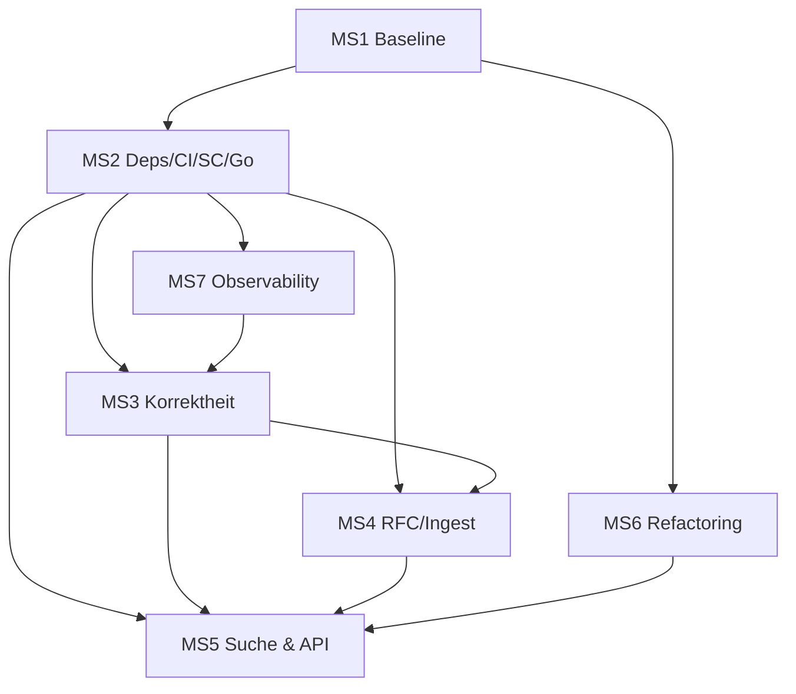

# Ekanite – Roadmap & Agent-Betriebsmodell

**Stand:** 2026-11-07 · 89 offene Issues · **Status: WORK IN PROGRESS — NICHT PRODUKTIONSREIF** (Begründung: kritische Sicherheitslücken offen, siehe §9).

---

## 0. Executive Summary

Die Software ist funktional (Ingest+Suche), aber nicht produktionsreif: 89 Issues über 7 Milestones, gruppiert in 4 parallele Workstreams (Lanes). Die Umsetzung erfolgt durch ein **Multi-Agenten-Modell**: Supervisor (Qualität/DoD), TaskManager (Orchestrierung/Dependency-Graph) und spezialisierte Worker-Agenten (8 Rollen). Die Reihenfolge ist als Wellen-Modell (Wave 0–3) mit klaren Gates modelliert; Parallelität wird über getrennte Eigentumsbereiche (Datei-Matrix) erzwungen.

---

## 1. Bestandsaufnahme & Review

### 1.1 Milestone-Last
| Milestone | Issues | Rolle | Status |
|---|---|---:|---|
| MS1 Baseline: Hygiene & Doku | 14 | Fundament; parallel | offen |
| MS2 Dependencies & Build-Gates + SC | 13 | kritischer Pfad | offen |
| MS3 Korrektheit & Stabilität | 29 | größte Last; in 4 Sub-Streams | offen |
| MS4 RFC-Konformität & Ingest | 8 | Produkt | offen |
| MS5 Suche & API | 8 | Produkt | offen |
| MS6 Modularität & Refactoring | 9 | parallel | offen |
| MS7 Observability & Monitoring | 8 | parallel | offen |

### 1.2 Review-Ergebnisse
- **Konsistenz:** Alle 89 Issues haben einen Milestone; keine Waisen. ✅
- **Label-Hygiene:** 17 Labels, keine Dubletten im Gebrauch; „performance“/„security“ korrekt belegt. ✅
- **Abhängigkeiten:** GitHub bietet keine nativem Issue-Dependencies — alle Kanten sind in Issue-Bodys dokumentiert und werden **hier** als ausführbares Modell kodiert (§2). 
- **Risiko:** MS3 (29) ist zu groß für einen Agenten → wird in 4 lösbare Sub-Streams aufgeteilt (§3, Lane B).
- **Doppelausführung-Schutz:** Umbrella-Issues (#88/#89/#42) sind **Abschlusskriterien**, keine Worker-Aufgaben; sie werden ausschließlich vom Supervisor bewertet.

---

## 2. Abhängigkeitsgraph

**Kritische Kanten (Issue-Ebene):**
- `#85 GO-2` ← `#80 SC-1` + `#19 CI`; `#86 GO-3` ← `#85`
- `#3 Race-Gate` ← `#2 bleve v2`; `#20 Batch-Default` ← `#2`; `#76 Datadir-Vertrag` ← `#2/#80`
- `#13 Lock-Race` ← Gate „-race grün“ (MS2); `#29/#30/#37` ← `#2` + `#13`
- `#15 SD-Parsing` ← `#16/#17` (gleiche Datei `parser/rfc5424.go`)
- `#18 Framing/UDP` ← `#14` (gleiche Datei `input/collector.go`)
- `#89 Test-Umbrella` ← `#22–#25` + `#75` + `#39`
- `#88 Doku-Umbrella` ← `#1/#26/#27/#28/#42/#79`
- `OPS-6` ← `MON-2`; `GAP-2` ← `#37`; `GAP-3` ← `#49`; `OPS-1` ← `#51/#49/#46`
- `MON-3 slog` ← `#85`; `MON-1 Prometheus` ← `#2`

---

## 3. Wellen- und Lane-Modell (Parallelisierung)

| Wave | Lane A Fundament | Lane B Stabilität | Lane C Produkt | Lane D Wartbarkeit/Obs |
|---|---|---|---|---|
| **W0** | MS1 (voll) + CLI-2 (#44) + GAP-1 (#72) | — | — | MS6-Strukturteile (Q5/Q6) |
| **W1** | MS2 (SC-1→SC-4, #85, #19, #3, #20) | — | — | — |
| **W2** | — | MS3: E1 Fehlerpfade, E2 Concurrency/DoS, E3 Parser, E4 Tests | MS4 (#15/#18) nach E3 | MS6-Rest + MS7 (nach MS2) |
| **W3** | — | Rest MS3 + #89 | MS5 (#29/#30/#37/#73) | OPS/GAP-Rest (nach MS5-Teilen) |

**MS3-Sub-Streams (Lane B):**
| Stream | Issues | Worker |
|---|---|---|
| E1 Fehlerpfade/Panik | #7, #8, #9, #46, #51 | EngineWorker |
| E2 Concurrency/DoS | #13, #14, #47, #48, #52 | IngestWorker/ServerWorker |
| E3 Parser-Korrektheit | #16, #17, #67, #22 | IngestWorker |
| E4 Test-Infrastruktur | #23–#25, #75, #89 | TestingAgent |

---

## 4. Agent-Architektur

### 4.1 Rollen
| Agent | Typ | Verantwortung |
|---|---|---|
| **SupervisorAgent** | Kontrolle | Besitzt Roadmap/Milestones/DoD; genehmigt Merges; bewertet Umbrella-Issues; führt End-zu-End-Verifikation aus; schreibt keine Produktionscode-Änderungen |
| **TaskManagerAgent** | Orchestrierung | Zerlegt Issues in Tasks; überwacht Dependency-Graph (§2); plant Lanes (§3); vergibt Eigentum (§4.3); sammelt Ergebnisse; aktualisiert Issue-Zustände (Labels `status:in-progress/blocked`); löst Datei-Konflikte |
| **IngestWorker** | Ausführend | Parser, Framing, Collector, UDP/TLS-Ingest (#15–#18, #33, F5/F7/F8, T1/T2, E2-Ingest-Anteil) |
| **EngineWorker** | Ausführend | Engine, Index, Suche, Retention, Batcher (#7/#8/#9/#13/#46/#51/#67, F1/F2, #21, MON-6) |
| **ServerWorker** | Ausführend | HTTP/Telnet/API/Auth/Timeouts (RES-3, #37, #48, GAP-2, #78) |
| **OpsWorker** | Ausführend | CLI/Konfiguration/Tuning/Deployment/systemd/Health (CLI-1..3, TUN-1..5, OPS-4, GAP-3, #72) |
| **ObservabilityWorker** | Ausführend | Metriken/Logging/Probes/OTel (MON-1..7, OPS-6) |
| **SupplyChainWorker** | Ausführend | Deps, Go-Version, CI, SCM, Vulnerabilities (MS2 komplett, SC-1..4, GO-2) |
| **TestingAgent** | Unterstützend | Test-first, Fuzz, Coverage, Regression-Harness (T1–T4, GO-6, GAP-4, E4) |
| **DocsAgent** | Unterstützend | README, CHANGELOG, GoDoc, OPERATIONS, ARCHITECTURE (D1–D3, GO-5, OPS-5, #79) |

### 4.2 Ablauf
1. TaskManager liest den Graph (§2), bildet die nächste ausführbare Task-Menge (keine offenen Vorgänger, Lane-Freiheit).
2. Worker übernimmt Task aus seiner Eigentumszone, arbeitet **Test-first** (TestingAgent unterstützt), meldet via Issue-Kommentar + Label.
3. Supervisor führt Gate-Prüfung (DoD des Milestones) aus; nicht erfüllt → zurück an Worker mit Befund.
4. TaskManager schließt Issue, deblockiert Nachfolger, meldet Fortschritt an Roadmap.

### 4.3 Datei-Eigentumsmatrix (Konfliktvermeidung)
| Datei | Eigentümer |
|---|---|
| `parser/*.go` | IngestWorker (E3) |
| `input/collector.go`, `input/delimiter_*.go` | IngestWorker (E2) |
| `engine.go`, `index.go`, `event.go` | EngineWorker |
| `server.go`, `server_http.go`, `status/service.go` | ServerWorker |
| `cmd/ekanited/main.go` | OpsWorker (nach MS1) |
| `go.mod`/CI/SCM | SupplyChainWorker |
| `docs/*`, `README.md`, `CHANGELOG.md` | DocsAgent |
| `*_test.go` | TestingAgent (koordiniert mit Fach-Worker) |

---

## 5. Gates (Wellen-Abschluss)

| Gate | Kriterium |
|---|---|
| G0 (nach W0) | `gofmt -l` leer; README/Flag-Texte synchron; #44/#72 fix; keine Work-in-progress-Doku-Reste |
| G1 (nach W1) | `-race` grün; `govulncheck` = 0; Go 1.26; keine archivierten Module; SBOM/Checksums im Release-Pfad |
| G2 (nach W2) | E1–E4 abgeschlossen: keine Panik-/Leck-Pfade, Parser-Grammatik gemäß #16/#17, Tests ≥ 85 % Kernpakete |
| G3 (nach W3) | #88/#89 geschlossen; API-Vertrag (#41) eingehalten; OPS-1..6/GAP-1..8 abgearbeitet; README-Banner „WIP“ entfernt nach finaler Verifikation |

---

## 6. Definition of Done (global)
- `go test -race ./...` grün; `govulncheck` = 0; `go vet`/Lint grün.
- Keine offenen kritischen Sicherheitsbefunde (S1-S7, RES-1..8 geklärt).
- Doku-Vertrag (#42) erfüllt; README spiegelt Realität.
- Release v1.4.0 mit SBOM, Checksums, CHANGELOG.

---

## 7. Risiken & Annahmen
- **Annahme:** Agenten arbeiten auf getrennten Eigentumszonen; Cross-Zonen-Änderungen nur über TaskManager-Tickets.
- **Risiko MS2:** bleve-v2-Migration ist der kritischste Pfad (#80); bei Fehlschlag → Gate G1 blockiert alles Weitere.
- **Risiko MS3-Last:** E3 (Parser) ist Voraussetzung für MS4; falls E3 länger dauert, verschieben sich MS4/MS5 nach rechts, nicht die Lanes D.
- **Risiko** GAP-1 flock (#72) ist bewusst in W0, da es Produktionsfalschbetrieb verhindert.

---

## 8. Referenzen
- Issues: #1–#89 (vollständig in GitHub).
- Sicherheitsbefunde: S1–S7 (aus initialer Analyse; in Issues #14/#52/#78/#7/#46/#67 verankert).

---

## 9. Warum NICHT produktionsreif (WIP-Begründung)
Kritische, offene Sicherheitslücken:
1. **Keine Authentifizierung auf Query-Ports** (#78/S1) — Logs öffentlich lesbar, sobald nicht-loopback gebunden.
2. **TCP-DoS**: unbegrenzte Verbindungen + Endlos-Timeout-Loop (#14).
3. **pprof ungeschützt** (#52) — Remote-CPU-Profile + Heap-Lecks.
4. **Stille Datenverluste**: Fehlerkanal sendet nur nil (#7); Batch-Leck (#46).
5. **Zukunfts-Indizes** (#67) — unbeschränktes Plattenwachstum durch fehlerhafte Sender.
